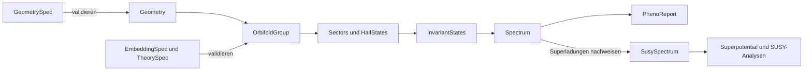

# 02 – Rust-Zielarchitektur

## Aktuell implementierte Architektur

Stand: 2026-11-14. Das Workspace enthält drei Crates. Der nachfolgende
Phase-1-Entwurf bleibt als historische Entwurfsgrundlage erhalten; seine
geplanten Namen und Fähigkeiten sind keine Beschreibung der heutigen API.

| Tatsächlicher Baustein | Verantwortung |
| --- | --- |
| `orbifolder-core::math_core` | Hybride rationale Arithmetik, Vektoren/Matrizen, Gitter, ADE-Wurzelsysteme und Charakteralgebra. |
| `orbifolder-core::geometry` | Raumgruppen, Smith-Normalform, validierte Geometrie/Einbettung, `TheorySpec`, Shifts, Wilsonlinien und Torsionsverträge. |
| `orbifolder-core::physics_engine` | Gemeinsame exakte Sektor-, Massenschalen-, Zustands- und Spektrumrechnung. |
| `orbifolder-core::anomalies` | Darstellungsindizes, chirale Spuren, U(1)-Basis, FI und Green–Schwarz-Prüfungen. |
| `orbifolder-core::susy` | SUSY-Spektrumsansicht, Monomiale und Auswahlregeln im Grad-1–3-Profil. |
| `orbifolder-core::analysis` | Gemeinsamer `Computation<T>`-Status für berechnete, nicht anwendbare und nicht unterstützte Analysen. |
| `orbifolder-core::execution` | Serielle Modellrechnung oder eigener wiederverwendbarer Rayon-Pool; geordnete Batch-Ergebnisse und Worker-Projektionen. |
| `orbifolder-data` | Versionierte strukturierte Eingaben, eingebettete Presets, In-Memory-Legacy-Textparser und exakter Ergebnis-/Summary-Transport. |
| `orbifolder-python` und `python/orbifolder` | Frozen PyO3-Klassen und Python-Hilfen; ausschließlich `load_legacy_file` liest am Python-Rand eine Datei. |

Abweichungen vom ursprünglichen Entwurf:

- Es gibt keine eigenen Module/Crates `theory`, `pheno`, `batch` oder
  `orbifolder-io` und keine öffentlichen `TheoryRules`-/`SupersymmetricRules`-
  Traits. Die Theorieauswahl verwendet `TheorySpec::{Susy, NonSusy}`.
- Rayon ist eine reguläre Core-Abhängigkeit, kein optionales Cargo-Feature.
  Parallelisiert werden Modelle; `Executor::serial()` verwendet keinen Pool.
- `Rational` speichert eigene kanonische `i128`-Paare und promoviert einzelne
  überlaufende Operationen nach `BigRational`, statt ganze Modellstufen zu
  wiederholen. Ein konfigurierbares BigInt-Bitlimit existiert nicht.
- Exakte JSON-Ausgaben enthalten Integer-Tokens für `num` und `den`, keine
  Dezimalstrings. Clients müssen beliebig große Ganzzahlen erhalten können.
- Die Python-Einstiege heißen `Model.from_data`/`from_text`, `Model.compute`,
  `Result.anomalies`/`couplings`/`superpotential` und
  `Executor.compute_many`/`compute_summaries`; siehe die installierten
  [Typdeklarationen](../python/orbifolder/__init__.pyi).
- Betafunktionen, SM-/PS-/SU(5)-Klassifikation, VEV-/Hintergrundtransformationen,
  numerische Massenmatrizen, Zufallsmodellgenerator und NumPy-Merkmalsexport
  sind nicht implementiert. Formale F-Term-Ableitungen existieren in Rust;
  sie sind keine öffentliche Python-Methode und kein numerischer VEV-Löser.

Die sieben zertifizierten Referenzfälle und die Grenzen für Spin(32),
nichttriviale Torsion und höhere Kopplungsgrade bleiben maßgeblich. Siehe
[aktueller Prüfstand](./12_repository_audit.md), [SUSY-Profil](./08_susy_verification.md)
und [Ubuntu-Setup](./11_development_ubuntu.md).

## Historischer Phase-1-Entwurf

Die folgenden Abschnitte dokumentieren die ursprünglich vorgesehenen Verträge.
Bei Abweichungen gilt die oben beschriebene Implementierung. Grundlage war das
[Domänenmodell](./01_domain_model.md); Reihenfolge und damalige Freigabeschritte
stehen im [Migrationsplan](./03_verification_and_migration_plan.md).

## Grenzen und Module

| Geplanter Baustein | Verantwortung |
| --- | --- |
| `orbifolder-core::math_core` | Geprüfte rationale Arithmetik, dimensionsgebundene Vektoren, Gitter/Nebenklassen, rationale lineare Algebra, Wurzelsysteme und Weyl-Reflexionen. |
| `orbifolder-core::geometry` | Torus-/Raumgruppendaten, bis zu drei zyklische Faktoren, Fixbranen, Zentralisatoren, Shifts/Wilsonlinien und validierte Einbettung. |
| `orbifolder-core::theory` | Gemeinsame Schnittstelle für Konstruktions-, GSO-, Nebenklassen- und Projektionsregeln von SUSY und non-SUSY. |
| `orbifolder-core::physics_engine` | Gemeinsame Halbzustands-, Projektions- und Darstellungspipeline; masselose und tachyonische Zustände; Superladungen und Multipletbildung. |
| `orbifolder-core::pheno` | Strukturierte Anomaliebefunde, Betafunktionen, Phänomenologie sowie SUSY-Monomiale, Superpotential und effektive Massenmatrizen. |
| `orbifolder-core::batch` | Optionales Rayon-Feature; Ausführung derselben reinen Modellfunktionen mit expliziten Ressourcenlimits. |
| `orbifolder-python` | PyO3-Bindings, immutable Ergebnisobjekte und In-Memory-Konvertierung; Paketierung mit maturin. |
| Optionaler Adapter `orbifolder-io` | Legacy-Import, versionierte Serialisierung und menschenlesbare Ausgabe. Der Core hängt nicht von diesem Adapter ab. |

Der Core benötigt weder Dateipfade noch Python-Objekte, Streams, Prozess-IDs oder globale Zufallszustände. Tabellen für Tensorprodukte werden vorab geladen, validiert und als unveränderliche Eingabe übergeben. Bewusst numerische Auswertungen irrationaler Observablen erhalten eine gesonderte Schnittstelle außerhalb des exakten diskreten Kerns.

## Exakte Zahlen als Vertrag

`Rational` kapselt zunächst `num-rational::Ratio<i128>`; öffentliche APIs exponieren den Backendtyp nicht. Zähler/Nenner sind gekürzt, Nenner positiv, Null ist `0/1`. Konstruktion und **sämtliche** Operationen einschließlich Vergleich, ggT/kgV und Zwischenprodukten prüfen Überläufe. Ungeprüfte Operatoren des Zahlentyps sind kein zulässiger interner Umweg; insbesondere müssen auch `i128::MIN` und Kreuzprodukte sicher behandelt werden.

Bei Überlauf wird die betroffene reine Berechnungsstufe mit `num-bigint`/`BigRational` wiederholt. Ein explizites Größenlimit liefert stattdessen einen arithmetischen Ressourcenfehler. Beide Wege erhalten die mathematische Semantik; ein Wechsel zu `f64` ist ausgeschlossen. Eine kleinere Ganzzahldarstellung oder gemeinsame Nenner sind spätere, durch Schranken und Benchmarks belegte Optimierungen.

| Größe | Exakte Darstellung und Regel |
| --- | --- |
| Translation, Eichvektor, Rechtsgewicht | Verschiedene Typen für sechs, 16 beziehungsweise vier rationale Komponenten; Vektoren verschiedener Räume sind nicht austauschbar. |
| Twists, Shifts, Wilsonlinien | Rationale Vektoren; Ordnung und Gitterzugehörigkeit über Ganzzahligkeit, Parität und Nebenklassen prüfen. |
| Oszillatoren und Massen | Frequenzen, Besetzungsbeiträge, Nullpunktsenergien und der dimensionslose Massenparameter `μ` rational. |
| Eigen-/Gamma-/Torsionsphase | `Phase = ℚ/ℤ` mit Repräsentant in `[0,1)`; Phasenaddition und Invarianz exakt. Keine numerische komplexe Exponentialfunktion zur Projektion. |
| Lie-Daten und U(1) | Ganzzahlige Dynkinlabels und Multiplizitäten; rationale Gewichte, Generatoren, Ladungen und Spuren. U(1)-Basis und Gram-Matrix bleiben Teil des Ergebnisses. |
| Normen und Weyl-Reflexion | Mit Normquadraten arbeiten; `s_α(x) = x − 2(x·α)/(α·α) α` benötigt keine Quadratwurzel. Auch Enumerationsgrenzen über rationale Ungleichungen und ganzzahlige Schranken bestimmen. |

**Keine pauschale Reduktion der Eingabevektoren modulo eins:** Nur eine bereits berechnete skalare Phase wird so normalisiert. Vollständige Twist-/Shift-Repräsentanten und Nebenklassen bleiben erhalten. Ebenso bleiben Raumgruppentranslationen in `ℚ⁶`; Fixpunktkoordinaten modulo Torusgitter erhalten einen eigenen Typ.

Die [Legacy-Z₃-Geometrie](../legacy_cpp/non_susy_orbifolder/Geometry/Geometry_Z3_1_1.txt#L44) enthält etwa `1.7320508076` als Näherung für eine irrationale Basiskomponente. Daraus entsteht durch Einlesen als Dezimalbruch noch keine exakte Kristallgeometrie. Der Core erhält stattdessen nachgewiesene rationale Gitteraktionen und, soweit benötigt, eine exakte Gram-Matrix; für einen entsprechenden A₂-Block beispielsweise `G = [[4,−2],[−2,4]]`. Der Importadapter muss die Zuordnung zur Legacy-Geometrie mit Herkunft, endlicher Rotationsordnung und Gitterrelationen belegen. Ungeklärte Zuordnungen liefern `UnsupportedExactGeometry`.

Für diskrete Spektren vermeiden Gitterkoordinaten und unnormierte rationale U(1)-Generatoren die meisten irrationalen Werte. Algebraische Ausdrücke wie Normierungswurzeln können symbolisch bleiben. `f64` ist auf ausdrücklich angeforderte numerische Auswertung unvermeidlich irrationaler Größen oder den externen C++-Vergleich beschränkt. Es entscheidet weder über Gittermitgliedschaft noch über Masselosigkeit, Projektion oder Anomaliefreiheit. Rationale ML-Merkmale werden ebenfalls exakt als Zähler-/Nennerdaten angeboten.

## Drei Faktoren und physikalische Konstruktion

`SpaceGroupElement` trägt immer `(m,n,k)` und eine rationale Translation. Die zugehörigen Faktorordnungen sind `(M,N,K)`; ungenutzte Faktoren haben Ordnung eins und Exponent null. Generatorreihenfolge und Importabbildung werden gespeichert:

| C++-Konvention | Kanonische Abbildung |
| --- | --- |
| [SUSY `(k_alt,l_alt)`](../legacy_cpp/susy_orbifolder/src/orbifolder/cspacegroupelement.h) | `(m,n,k) = (k_alt,l_alt,0)`; bei einem Faktor zusätzlich `n=0`. |
| [non-SUSY `(m,n,k)`](../legacy_cpp/non_susy_orbifolder/src/orbifolder/cspacegroupelement.h) | Identische Reihenfolge; der zusätzliche erste Faktor bleibt erhalten. |

Eine Generatorbeschreibung enthält die rationale Torusrotation, gegebenenfalls Translation und den vollständigen vierkomponentigen Spin-Twist. Insbesondere besitzt das [non-SUSY-Z₃-Beispiel](../legacy_cpp/non_susy_orbifolder/Geometry/Geometry_Z3_1_1.txt#L15) den Twist `(0,1,1,1)`: seine Torusrotation ist trivial, seine Spinorwirkung kann ein Vorzeichen tragen. Die Ordnung der Torusmatrix darf deshalb ein echter Teiler der Faktorordnung sein. Bei Rototranslationen kann außerdem eine Generatorpotenz eine Gittertranslation ergeben; die vollständigen Raumgruppenrelationen sind zu prüfen.

`TheorySpec` bezeichnet die heterotische Konstruktion, `GaugeLattice` die Impulsdarstellung und `GaugeAlgebra` die überlebenden Wurzeln. Diese Begriffe bleiben getrennt: Die [non-SUSY-Modelldatei](../legacy_cpp/non_susy_orbifolder/Models/ZN_models/modelZ3_1_1.txt) verwendet weiterhin `E8xE8`. SO(16)×SO(16) benötigt die zugehörigen Brechungs-/Projektionsregeln und zulässigen Nebenklassen; ein umbenanntes E8-Gitter reicht nicht. Mathematische Gitterbausteine umfassen E8, D₈ und D₁₆⁺. Die tatsächlich erhaltene Raumzeit-Supersymmetrie wird aus invarianten Superladungen berechnet.

## Eine Zustandspipeline, getrennte Regeln

| Geplanter Vertrag | Aufgabe |
| --- | --- |
| `GaugeLatticeRules` | Zulässige Impulsnebenklassen und Mitgliedschaftstests in derselben exakten Gitterarithmetik. |
| `TheoryRules: Send + Sync` | Für einen Sektor zulässige Links-/Rechtsklassen, GSO-/Projektionsbeiträge und Teilchenklassifikation liefern; Implementierungen `SusyRules` und `NonSusyRules` besitzen keine veränderlichen Caches. |
| `SupersymmetricRules` | Zusätzliche Regeln für nachgewiesene SUSY-Multipletbildung und Superpotentialanalysen; Verfügbarkeit erfordert tatsächlich erhaltene Superladungen. |

Die Trait-Implementierungen wählen Daten und Regeln. Gewichtsenumeration, Massenabgleich, Gruppierung nach Eigenphasen, Zentralisatorprojektion und Darstellungserkennung werden jeweils **einmal** implementiert. Die Konstruktionsvariante wird am Einstieg gewählt; spezialisierte Trait-Aufrufe vermeiden wiederholte dynamische Auswahl in den inneren Schleifen.

Der gemeinsame Löser berechnet

`μ_L = ½(p + V_g)² + N_L + a_L`, `μ_R = ½(q + v_g)² + N_R + a_R`.

Er verlangt exakt `μ_L = μ_R`; ein explizites `MassWindow` wählt `μ=0` beziehungsweise `μ<0`. Dieselbe Enumeration verarbeitet Grundzustände und angeregte Tachyonen. Physikalische Suchschranken werden hergeleitet; Abbruch durch Ressourcenlimits ist ein Fehler oder ein ausdrücklich unvollständiges Resultat, niemals ein vollständiges leeres Spektrum. Die C++-Massennormierung wird im Oracle-Protokoll festgehalten.

| Ergebnis-/Enumtyp | Inhalt |
| --- | --- |
| `HalfState` | Bewegungsrichtung, exakte Gewichte, Oszillatorbelegung, `μ` und Eigenphasen; feste IDs statt Rückverweisen auf veränderliche Container. |
| `So8Class` | `VectorV`, `SpinorS`, `CospinorC` entsprechend den [non-SUSY-Klassen](../legacy_cpp/non_susy_orbifolder/src/orbifolder/clatticevector.h); Klasse des unverschobenen `q` und verschobenes `q_sh` bleiben unterscheidbar. |
| `InvariantState` | IDs der Halbzustände, Lokalisation, Projektions-/Gamma-Daten und exakter gemeinsamer Massenparameter. |
| `ComponentKind`, `MassClass` | Fermion mit Spin/Händigkeit oder Boson mit Spin (`2s` ganzzahlig); unabhängig davon `Massless` oder `Tachyonic { μ, excitation }`. Modulusrollen und CPT-Zuordnung werden explizit gespeichert. |
| `Field`, `Spectrum` | Darstellung einschließlich Dynkin-Höchstgewichten, Gewichten, U(1)-/diskreten Ladungen, Lokalisation, Teilchenart, Massenklasse und Multiplizität; dazu gemeinsame Wurzel-/Ladungsbasis. |
| `SusyMultiplet`, `SusySpectrum` | Chirale, Vektor-, Hyper-, Halbhyper- und Gravitationsmultiplets als Gruppierung bereits erzeugter Komponenten. Der validierte SUSY-Wrapper referenziert dieselben Felddaten. |
| `Monomial`, `Superpotential` | Ganzzahlige Exponenten und stabile Superfeld-IDs; exakte Eich-/Raumgruppen-/Phasenregeln. Zulässige Kopplung, symbolischer Koeffizient und numerisch ausgewertete Stärke sind verschiedene Angaben. |

Multipletansicht und Komponentenansicht verdoppeln keine Freiheitsgrade. Anomaliesummen zählen die durch die festgelegte CPT-/Chiralitätskonvention unabhängigen Fermionen genau einmal. SUSY-Monomiale, F-/D-Term- und Massenmatrixanalysen greifen auf die validierte SUSY-Ansicht zu; non-SUSY erhält für ein Superpotential `NotApplicable`. Allgemeine non-SUSY-Wechselwirkungen wären eine eigenständige spätere Fähigkeit. Die bestehenden [SUSY-Kopplungen](../legacy_cpp/susy_orbifolder/src/orbifolder/cyukawacouplings.h) und [Monomiale](../legacy_cpp/susy_orbifolder/src/orbifolder/cmonomial.h) liefern die jeweiligen Oracle-Referenzen.

## Unveränderliche Typ-Transformationen

| Reine Operation | Vertrag |
| --- | --- |
| `build_geometry` | `GeometrySpec → Result<Geometry, GeometryError>`; exakte Aktionen, Ordnungen, Relationen und Gitterverträglichkeit prüfen. |
| `embed` | `Geometry + EmbeddingSpec + TheorySpec → Result<OrbifoldGroup, ModelError>`; Wilsonlinien-Relationen, Ordnungen, Spin-/Eich-Konsistenz und modulare Invarianz prüfen. |
| `solve_sectors`, `project`, `build_spectrum` | Ausschließlich validierte Eingaben lesen; jeweils ein neues abgeschlossenes Ergebnis mit stabilen IDs liefern. |
| `analyze` | `Spectrum + AnalysisRequest → Result<PhenoReport, AnalysisError>`; exakte Spuren und Anomaliekoeffizienten samt Bewertung zurückgeben. |
| `change_background` | `ModelSpec + BackgroundSpec → Result<neues Modell, ModelError>`; VEVs oder eine neue Ladungsbasis lösen eine explizite neue Transformation aus. |

Validierte Typen besitzen private Felder und ausschließlich prüfende Konstruktoren. Deserialisierung führt über die Eingabespezifikationen; ein fremdes `checked=true` kann keine Validierung umgehen. Externe IDs werden beim Import geprüft und auf lokale stabile IDs abgebildet. `CheckStatus`, `Access*`, `Reset` und öffentlich teilinitialisierte Modelle entfallen.

Lokale veränderliche Arbeitsvektoren innerhalb einer Funktion sind zulässig; sie entweichen nicht. Gemeinsame Geometrien und Tabellen können über `Arc` geteilt werden. Wiederverwendung ist explizit: vorberechnete Geometrie-/Rechtssektordaten werden als immutable Eingabe mit vollständigem Schlüssel aus Geometrie, Spinstruktur, Theorie und Suchprofil übergeben. Geometriegleichheit allein genügt nicht für die Wiederverwendung aller Rechtsbeweger.

`AnomalyReport` unterscheidet rohe Koeffizienten, globale Anomalieprüfungen und Green–Schwarz-/Universalitätsbedingungen. Ein anomales U(1) verlangt nicht, dass jede einzelne Spur verschwindet. Ein Ergebnis kennzeichnet `Computed`, `NotRequested`, `NotApplicable` oder `Unsupported`; fehlende Auswertung wird nicht als Nullkoeffizient dargestellt. Fachfehler, arithmetische Grenzen und Ausführungsabbrüche bleiben unterscheidbar.

## Parallelisierung und Python-API

Rayon parallelisiert vorrangig unabhängige Modelle; bei einer einzelnen großen Rechnung optional unabhängige Sektoren. Ein expliziter Pool und ein Parallelitätsbudget verhindern unkontrollierte Verschachtelung. Jeder Auftrag besitzt eigene Arbeitsdaten. Zufallssuchen erhalten einen expliziten Seed pro Modell; dessen Ableitung hängt nicht von Worker- oder Ausführungsreihenfolge ab.

Batch-Ergebnisse bleiben nach Eingabeindex geordnet und enthalten pro Modell Erfolg oder Fehler. Interne Mengen werden vor Vergabe stabiler IDs deterministisch sortiert; Multiplizitäten bleiben erhalten. Der Scheduler verändert keine physikalischen Summations- oder Auswahlregeln. Kandidaten-, Speicher- und BigInt-Grenzen sowie begrenzte Batchgrößen sind explizite Ausführungsoptionen. Große Gewichtstabellen verwenden gemeinsame Speicherbereiche und Indizes; Optimierungen werden gegen denselben seriellen Oracle-Pfad geprüft.

| Geplante Python-Oberfläche | In-Memory-Vertrag |
| --- | --- |
| `Geometry.from_data(...)`, `ModelSpec(...)` | Ordnungen, rationale Aktionen/Twists/Shifts, sechs Wilsonlinien und Theorie-/Torsionsdaten; keine Dateipfade erforderlich. |
| `compute_spectrum(model, mass_window=...)` | Immutable `Spectrum` mit exakten Ladungen, Gewichten, Massen und Lokalisation. |
| `analyze(spectrum, request=...)` | Strukturierte Anomalie-/Phänomenologiedaten; Ausgabeformatierung bleibt beim Aufrufer. |
| `compute_superpotential(susy_spectrum, max_degree=...)` | Validierte SUSY-Ansicht und explizite Ordnungsgrenze; Ergebnis enthält Abdeckungs-/Vollständigkeitsangaben. |
| `compute_many(models, execution=...)` | Geordnete Modellresultate; explizite Threads, Limits und Fehler pro Modell. |
| `to_exact_data()`, `to_features(...)` | Exakte Python-Ganzzahlen-/Zähler-Nenner-Paare beziehungsweise Integer-Merkmalsarrays mit Basis-/Konventionsmetadaten; irrationale Observablen werden gesondert ausgewertet. |

Rationale Eingaben akzeptieren Ganzzahlen, Zähler-Nenner-Paare oder rationale Strings; `Fraction` kann über `numerator`/`denominator` übernommen werden. Float-Eingaben für exakte diskrete Modelldaten werden zurückgewiesen. JSON transportiert Zähler/Nenner als Dezimalstrings und bleibt damit unabhängig von der Ganzzahlpräzision eines JSON-Clients.

Vor CPU-Arbeit kopiert beziehungsweise übernimmt der Adapter die benötigten Daten in Rust-Eigentum und gibt den GIL frei. Worker halten keine Python-Referenzen und leihen keine veränderlichen Python-Puffer. PyO3-Wrapper exponieren nur lesbare Eigenschaften, beispielsweise über `frozen`-Klassen; Fehler werden nach Rückkehr in Python übersetzt. Ein optionaler NumPy-Export verwendet geprüfte Integerbreiten und Zähler-/Nennerarrays; Werte außerhalb dieser Breiten bleiben Python-Ganzzahlen. Nebenläufigkeit und die unterstützten Python-Runtimes werden vor Veröffentlichung geprüft.
